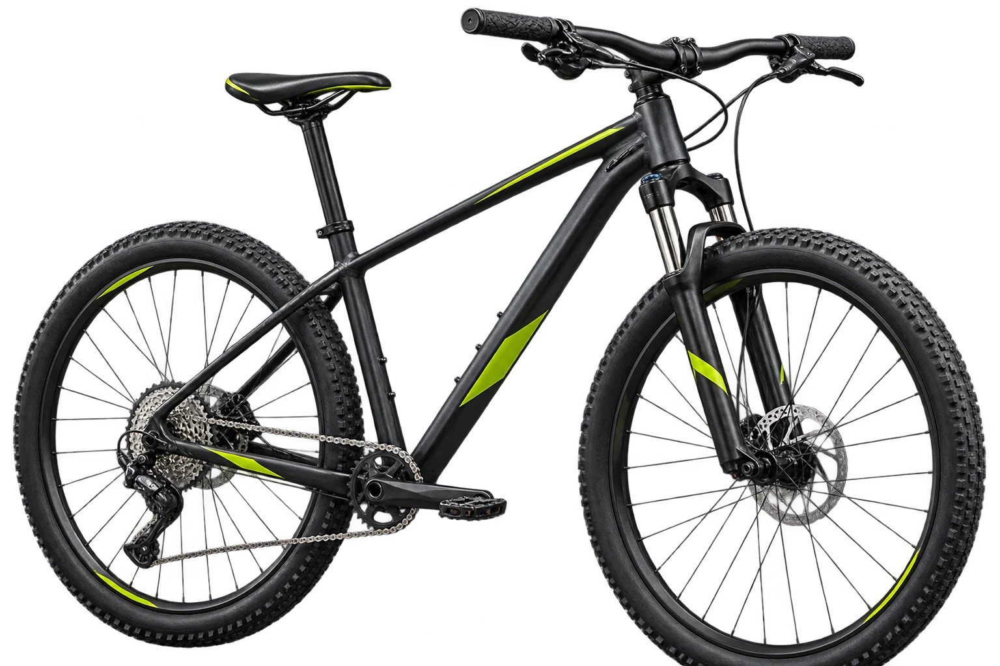
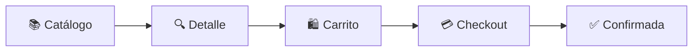
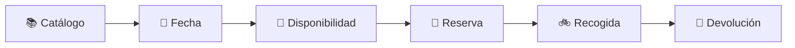
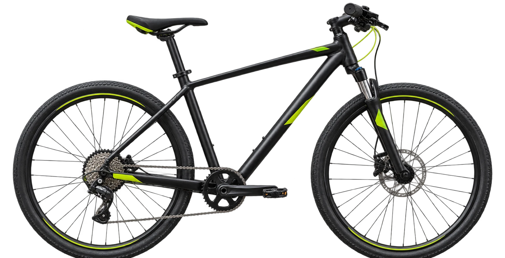
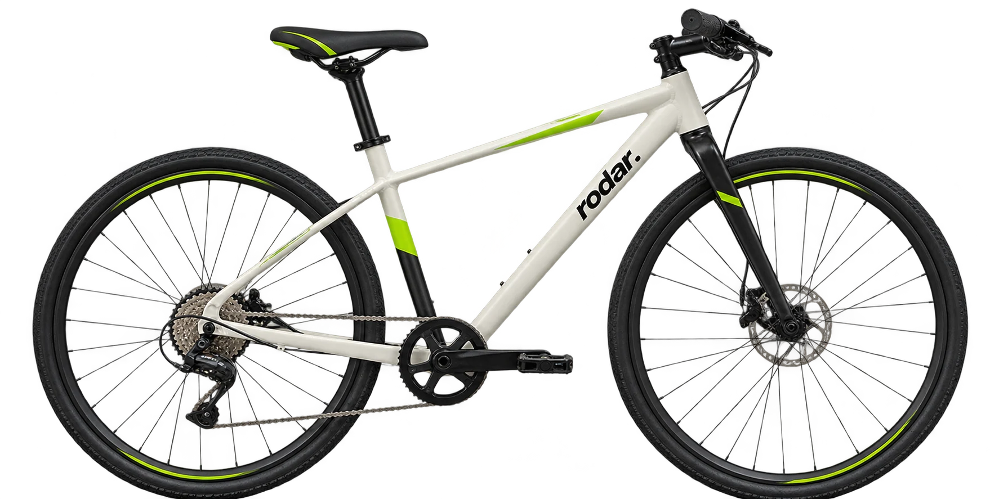
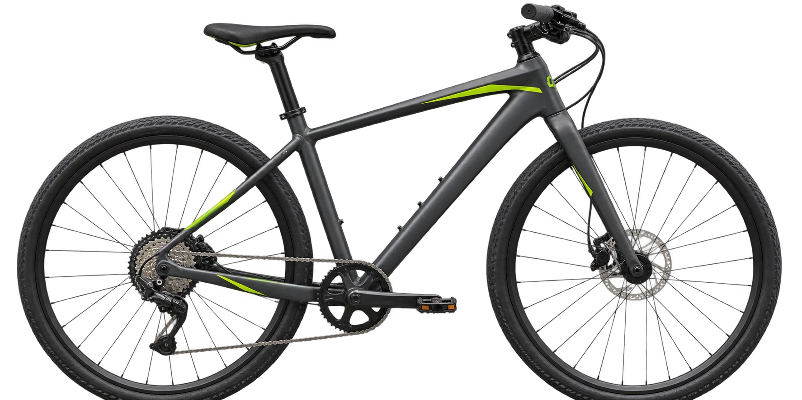
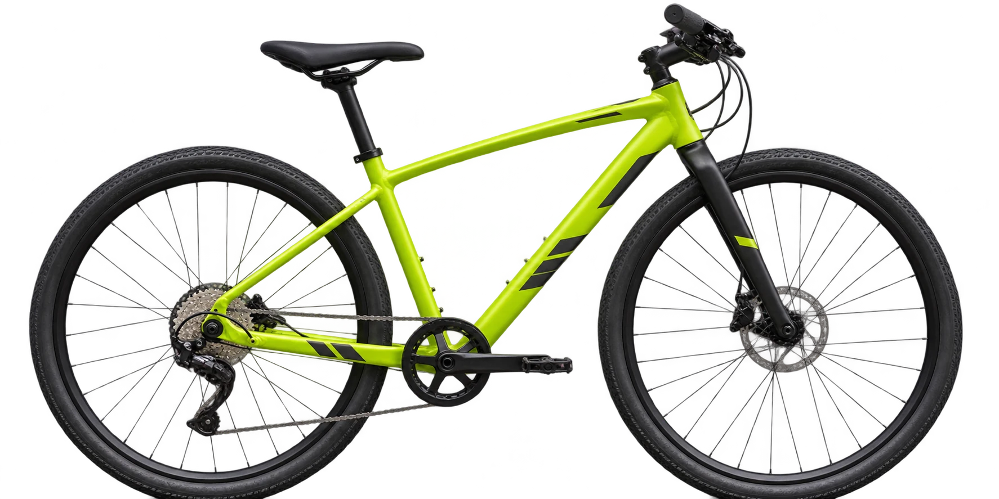
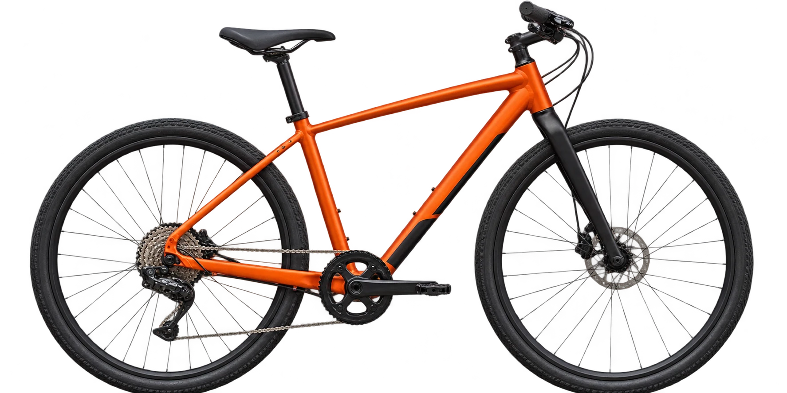
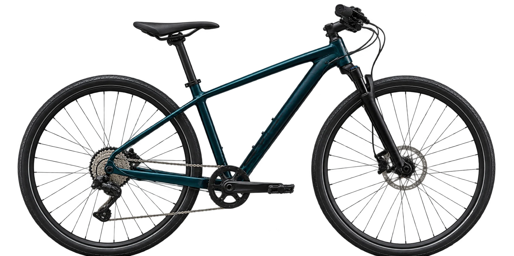
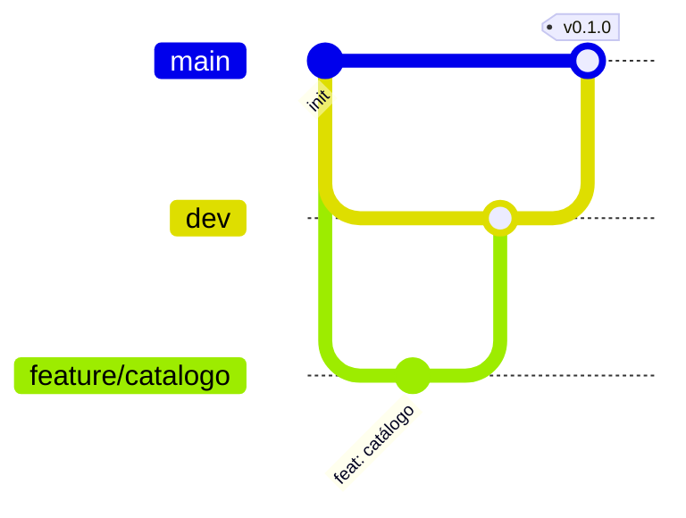

<div align="center">



# 🚲 rodar.

### *El camino es tuyo.*

**Compra · Alquila · Explora**

Plataforma web para **comprar y alquilar bicicletas y accesorios**: estética de marca deportiva, composición de revista de ciclismo y claridad de e‑commerce.

<br/>


<br/>

[🎨 Figma](https://www.figma.com/design/eDtp8saWOrO8euLOza5IGW/Rodar-%E2%80%94-Web-Design-v1.0) ·
[📘 Guía de marca](./Rodar_Brand_Guidelines.html) ·
[🚀 Inicio rápido](#-inicio-rápido) ·
[🤝 Cómo contribuir](#-normas-de-ingeniería-git-y-versionado)

**#SiempreHayUnaNuevaRuta**

</div>

---

## 📑 Tabla de Contenidos

- [📌 Contexto y Problema](#-contexto-y-problema)
- [🎯 Objetivo del MVP](#-objetivo-del-mvp)
- [🛣️ Una Tienda, Dos Caminos](#️-una-tienda-dos-caminos)
- [⚙️ Reglas de Negocio](#️-reglas-de-negocio)
- [👤 Historias de Usuario](#-historias-de-usuario)
- [🖥️ Pantallas](#️-pantallas)
- [🎨 Identidad Visual](#-identidad-visual)
- [🧰 Stack Tecnológico](#-stack-tecnológico)
- [📐 Alcance](#-alcance)
- [📁 Estructura](#-estructura-del-repositorio)
- [🚀 Inicio Rápido](#-inicio-rápido)
- [🌿 Normas de Ingeniería](#-normas-de-ingeniería-git-y-versionado)

---

## 📌 Contexto y Problema

Moverse en bicicleta por la ciudad es cada vez más común, pero quien quiere empezar a rodar se encuentra con barreras: no sabe qué bicicleta le sirve, no siempre quiere (o puede) comprar una, y las opciones de alquiler suelen ser informales o poco claras.

Hoy no existe un canal digital sencillo donde una persona pueda:

| | Necesidad |
|:-:|---|
| 🔎 | **Explorar un catálogo** de bicicletas y accesorios por estilo: Montaña, Ruta y Urbana. |
| 🔀 | **Decidir entre comprar o alquilar** en el mismo lugar, sin complicaciones. |
| 📅 | **Reservar por horas o por días** con disponibilidad confirmada. |
| 👤 | **Consultar sus compras y reservas** desde una cuenta personal. |

Y la tienda necesita controlar en **un solo panel** su inventario, ventas y alquileres, sin hojas de cálculo ni registros manuales.

<table>
<tr>
<td align="center" width="33%">🕊️<br/><b>Libertad</b><br/><sub>Elegir tu ruta, tu bicicleta y tu tiempo.</sub></td>
<td align="center" width="33%">⚡<br/><b>Movimiento</b><br/><sub>Una identidad activa, sin ruido visual.</sub></td>
<td align="center" width="33%">🤝<br/><b>Accesibilidad</b><br/><sub>Comprar o alquilar sin complicaciones.</sub></td>
</tr>
</table>

## 🎯 Objetivo del MVP

Construir una plataforma web **responsiva y mobile first** que:

- [x] 🏁 Presente la marca **rodar.** y su propuesta: *una tienda, dos caminos*.
- [ ] 🛒 Permita **comprar** bicicletas y accesorios con un flujo completo (checkout simulado).
- [ ] ⏱️ Permita **alquilar** por hora o por día, validando disponibilidad.
- [ ] 👤 Ofrezca una **cuenta** con historial de compras y reservas.
- [ ] 🛠️ Provea un **panel de administración** para inventario, ventas y reservas.

> [!NOTE]
> La casilla marcada refleja que la identidad y el diseño ya están definidos (guía de marca + Figma). El resto está por construir.

## 🛣️ Una Tienda, Dos Caminos

### 🛒 Comprar — *"Hazla tuya."*



### ⏱️ Alquilar — *"Tu próxima aventura, por horas."*



**Categorías:** ⛰️ Montaña · 🏁 Ruta · 🏙️ Urbana

> [!NOTE]
> **Política de precios:** precios y productos del MVP son **ficticios**, en pesos colombianos (COP). El alquiler se cobra **por hora** o **por día**. No se procesan pagos reales.

## ⚙️ Reglas de Negocio

| ✅ El sistema DEBE | 🛑 El sistema NO DEBE |
|---|---|
| Validar stock y disponibilidad **en el servidor** | Permitir reservas superpuestas de la misma bicicleta |
| Usar **operaciones atómicas** al comprar o reservar | Vender una bicicleta sin stock |
| Separar el **estado físico** de la bici del **estado de la reserva** | Comunicar errores o éxitos solo con color |
| Mostrar estados de **carga, vacío, error y éxito** | Bloquear la navegación con animaciones |
| Explicar qué pasó y cómo solucionarlo en cada error | Procesar pagos reales |

## 👤 Historias de Usuario

| ID | Historia | Descripción |
|:-:|---|---|
| 🏁 **R1** | Descubrir la marca | El Hero (*"El camino es tuyo."*) presenta rodar. y lleva a **Comprar** o **Alquilar**. |
| 🔎 **R2** | Explorar el catálogo | Categorías, búsqueda y filtros (panel lateral en mobile). |
| 🚲 **R3** | Ver el detalle | Fotos, especificaciones (ej. *MTB · Rin 29*), precio y acción de compra o reserva. |
| 🛒 **R4** | Comprar | Carrito en panel lateral, checkout simulado y confirmación. |
| ⏱️ **R5** | Alquilar | Fecha, tarifa y duración con total en tiempo real → *"¡Todo listo para rodar!"* |
| 👤 **R6** | Mi cuenta | Registro, inicio de sesión e historial de compras y reservas. |
| 🛠️ **R7** | Administrar la tienda | Panel privado: dashboard, inventario, ventas y reservas (entregar / devolver). |

## 🖥️ Pantallas

Diseño completo en **[🎨 Figma — Rodar Web Design v1.0](https://www.figma.com/design/eDtp8saWOrO8euLOza5IGW/Rodar-%E2%80%94-Web-Design-v1.0)**. Cada pantalla existe en **🖥️ Desktop** y **📱 Mobile**.

| 🏪 Tienda | ⏱️ Alquiler | 👤 Cuenta | 🛠️ Admin |
|---|---|---|---|
| Inicio | Alquiler | Iniciar sesión | Dashboard |
| Catálogo | Reserva | Registro | Inventario |
| Detalle de producto | Reserva confirmada | Mi cuenta | Ventas |
| Carrito | | | Reservas |
| Checkout | | | |
| Compra confirmada | | | |

## 🎨 Identidad Visual

| | |
|---|---|
| 🏷️ **Marca** | rodar. |
| 💬 **Eslogan** | El camino es tuyo. |
| 🔖 **Tagline** | Compra. Alquila. Explora. |
| 📰 **Estilo** | Sport Editorial × Urban Lifestyle |

### 🎨 Paleta

| Muestra | Color | Hex | Uso |
|:-:|---|---|---|
|  | **Electric Lime** | `#D4FA38` | Acciones, acentos y campañas |
|  | **Carbon Black** | `#151515` | Titulares y contraste |
|  | **Chalk White** | `#F5F5F0` | Fondo principal |
|  | **Concrete** | `#E5E5E0` | Superficies y divisores |
|  | **Asphalt** | `#737373` | Texto secundario |

> [!TIP]
> Siempre texto **negro sobre lima**; nunca texto blanco sobre lima.

### 🔤 Tipografía y tokens

| Elemento | Valor |
|---|---|
| 🅰️ Títulos | **Space Grotesk** Bold |
| 📝 Cuerpo | **Inter** Regular / Medium (vía `next/font`) |
| ✨ Iconos | Lucide, 20–24 px |
| ⬜ Radios | 8–12 px |
| 📏 Espaciado | 4 · 8 · 12 · 16 · 24 · 32 · 48 · 64 px |
| 📦 Contenedor | 1440 px máximo |
| ♿ Accesibilidad | Contraste AA, foco visible, objetivos táctiles de 44 px |

### 🚲 Colección de bicicletas

<table>
<tr>
<td align="center"><br/><sub><b>Negra</b></sub></td>
<td align="center"><br/><sub><b>Blanca</b></sub></td>
<td align="center"><br/><sub><b>Gris grafito</b></sub></td>
</tr>
<tr>
<td align="center"><br/><sub><b>Verde lima</b></sub></td>
<td align="center"><br/><sub><b>Naranja</b></sub></td>
<td align="center"><br/><sub><b>Azul petróleo</b></sub></td>
</tr>
</table>

<details>
<summary>🎬 <b>Motion</b> — tiempos de animación</summary>
<br/>

| Interacción | Comportamiento |
|---|---|
| 🦸 Hero | Reveal escalonado, 400–600 ms |
| 🃏 Cards | Zoom 1.04 en hover, 250 ms |
| 📜 Scroll | Entrada suave, una vez por sección |
| 🔘 Botones | Flecha o desplazamiento sutil, 150–200 ms |
| 🛍️ Carrito | Panel lateral, 250–300 ms |
| 📅 Reserva | Transición entre pasos, 200 ms |
| ✅ Confirmación | Check animado, 300 ms |

Solo se animan `transform` y `opacity`, y se respeta `prefers-reduced-motion`.

</details>

<details>
<summary>🗣️ <b>Voz de marca</b> — copys clave</summary>
<br/>

| Contexto | Copy |
|---|---|
| Hero | *El camino es tuyo.* |
| Catálogo | *Encuentra tu ritmo.* |
| Alquiler | *Tu próxima aventura, por horas.* |
| Compra | *Hazla tuya.* |
| Carrito vacío | *Todavía no has empezado a rodar.* |
| Reserva exitosa | *¡Todo listo para rodar!* |
| Footer | *Siempre hay una nueva ruta.* |

Voz **cercana, directa y motivadora**.

</details>

📘 Guía completa: [`Rodar_Brand_Guidelines.html`](./Rodar_Brand_Guidelines.html)

## 🧰 Stack Tecnológico

<div align="center">


</div>

| | Tecnología | Responsabilidad |
|:-:|---|---|
| ⚛️ | **Next.js 16.4 (App Router) + React 19.3 + TypeScript** | Frontend y lógica de negocio |
| 🎨 | **Tailwind CSS 4.3 + shadcn/ui** | Tokens de diseño y componentes |
| ✨ | **Motion + Lucide** | Animaciones e iconografía |
| 🗄️ | **Supabase** | PostgreSQL, Auth, Storage y RLS |
| 🚀 | **Vercel + GitHub** | Despliegue y colaboración |

### ⚠️ Next.js 16: leer antes de programar

> [!WARNING]
> Esta versión de Next.js tiene **cambios importantes** en APIs, convenciones y estructura de archivos (muchos tutoriales y asistentes de IA aún no los conocen). Como indica [`rodar-web/AGENTS.md`](./rodar-web/AGENTS.md):
>
> - 📖 **Antes de escribir código**, lee la guía correspondiente en `rodar-web/node_modules/next/dist/docs/` (disponible después de `npm install`).
> - 🚧 **Atiende los avisos de deprecación** en consola y en la documentación.
> - 🔁 `next dev` reescribe el bloque de `AGENTS.md`; si aparece como cambio pendiente, inclúyelo en tu commit en vez de borrarlo.

<details>
<summary>⚙️ <b>Configuración actual</b> de <code>next.config.ts</code></summary>
<br/>

| Opción | Qué hace |
|---|---|
| `cacheComponents: true` | Activa Cache Components (caché a nivel de componente) |
| `partialPrefetching: true` | Prefetch parcial de rutas |
| `experimental.agentFeedback: true` | Feedback del servidor de desarrollo para agentes de IA |
| `turbopack.rules["*.css"]` | Procesa el CSS con `@tailwindcss/turbopack` (Tailwind 4) |

Los layouts usan los tipos globales de rutas de Next 16 (ej. `LayoutProps<"/">`) y las fuentes se cargan con `next/font/google`.

</details>

## 📐 Alcance

<table>
<tr>
<th width="50%">✅ Dentro del alcance</th>
<th width="50%">❌ Fuera del alcance</th>
</tr>
<tr valign="top">
<td>

- 🏁 Landing con Hero editorial y los dos caminos
- 📚 Catálogo con categorías, búsqueda y filtros
- 🔍 Detalle de producto
- 🛒 Carrito, checkout simulado y confirmación
- ⏱️ Alquiler por hora / día con disponibilidad
- 👤 Registro, login y "Mi cuenta"
- 🛠️ Panel admin: dashboard, inventario, ventas, reservas
- 📱 Diseño 100% responsivo

</td>
<td>

- 💳 Pagos reales o pasarelas de pago
- 📍 Seguimiento GPS de bicicletas
- 🧊 Visualización 3D de productos
- 📲 Apps móviles nativas (iOS / Android)

</td>
</tr>
</table>

### 📦 Entregables

| 💻 Código fuente | 🌐 Web publicada | 🎥 Video explicativo | 🎪 Demo en la feria |
|:-:|:-:|:-:|:-:|
| Este repositorio | Vercel | Presentación del proyecto | Stand con póster y QR |

## 📁 Estructura del Repositorio

```text
RODAR/
├── 📘 Rodar_Brand_Guidelines.html   # Guía de marca y UI
├── 📄 README.md
└── 🚲 rodar-web/                    # Aplicación Next.js
    ├── 🤖 AGENTS.md                 # Reglas de Next.js 16 (leer antes de programar)
    ├── ⚙️ next.config.ts            # Configuración de Next.js
    ├── 📂 app/                      # Rutas y layouts (App Router)
    └── 🖼️ public/bicicletas/        # Fotos de producto (.png / .webp)
```

## 🚀 Inicio Rápido

### 1️⃣ Clonar el repositorio

```bash
git clone https://github.com/REN-ORDO/Rodar.git
cd Rodar
```

### 2️⃣ Instalar y correr la app

```bash
cd rodar-web
npm install
npm run dev
```

Abrir 👉 [http://localhost:3000](http://localhost:3000)

| Comando | Para qué |
|---|---|
| `npm run dev` | 🔥 Servidor de desarrollo |
| `npm run build` | 📦 Compilar para producción |
| `npm run start` | ▶️ Servir la build |
| `npm run lint` | 🧹 Revisar el código con ESLint |

> [!IMPORTANT]
> Antes de tu primera tarea, revisa [`rodar-web/AGENTS.md`](./rodar-web/AGENTS.md) y la documentación en `node_modules/next/dist/docs/`.

### 3️⃣ Flujo de trabajo para una nueva tarea

```bash
# 🔄 Cambiar a dev y actualizar
git checkout dev
git pull origin dev

# 🌿 Crear nueva rama de trabajo
git checkout -b feature/nombre-de-tu-tarea

# 💾 Commits con Conventional Commits
git commit -m "feat(catalogo): agrega filtros por categoría"

# 🚀 Pushear únicamente tu rama temporal
git push -u origin feature/nombre-de-tu-tarea
```

## 🌿 Normas de Ingeniería, Git y Versionado

> [!IMPORTANT]
> **Consulta obligatoria antes de contribuir:** revisa `rules.md` para conocer en detalle las reglas del equipo.



| | Norma | Detalle |
|:-:|---|---|
| 🥇 | **Regla de Oro** | Prohibido el push directo a `main` y `dev`; siempre rama temporal (`feature/*`, `bugfix/*`, `docs/*`). |
| 🔀 | **Flujo de integración** | Ramas temporales → `dev` → `main` |
| 📝 | **Conventional Commits** | `feat` · `fix` · `docs` · `style` · `refactor` · `test` · `chore` |
| 🏷️ | **SemVer** | El MVP arranca en `v0.x.x` con tags anotados (`git tag -a v0.1.0`) |
| 🔍 | **Pull Requests** | Pequeños (≤ 300 líneas) y con revisión cruzada entre compañeros |

---

<div align="center">


### rodar.

*Sencillo de desarrollar. Memorable de utilizar.*

**Siempre hay una nueva ruta.** 🚲💨

</div>
